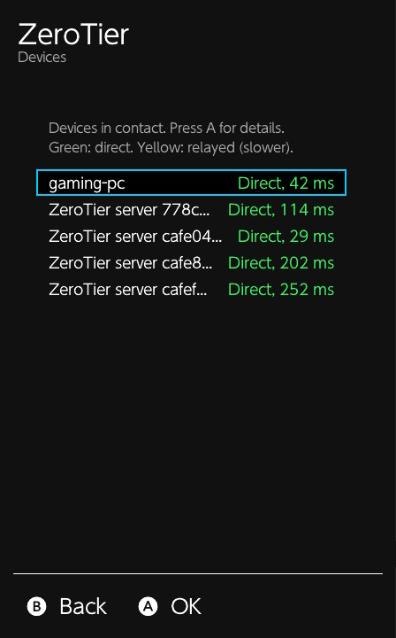

# zerotier-nx

[](https://github.com/UnderwaterOverground/zerotier-nx/releases/latest)
[](#license)
[](https://discord.gg/YgHetJguaF)

ZeroTier for the Nintendo Switch. Runs in the background on Atmosphère and puts homebrew on your ZeroTier network, so you can use Moonlight, reach your NAS, or access your home network away from home.

No port forwarding and no server of your own: devices on the network find each other through ZeroTier, and connect directly whenever the network allows.

> Unofficial project. Not affiliated with Nintendo or ZeroTier, Inc. ZeroTier is a trademark of ZeroTier, Inc.

## Features



- Runs at boot, and reconnects after sleep and when the Wi-Fi changes or drops.
- Works with homebrew launched through hbmenu, including supported home-screen forwarders.
- Joins any ZeroTier network: one made at [my.zerotier.com](https://my.zerotier.com) or on your own controller.
- Managed routes work, so a member acting as a router can give the Switch your whole home network.
- Names for devices, so Moonlight finds your PC by name.
- Ultrahand overlay for status, this Switch's ZeroTier ID, the devices in contact (direct or relayed, and latency), and pause/start/stop.
- Optional update notifications and [sys-ftpd](https://github.com/cathery/sys-ftpd) access over the network.
- Fixed 2.5 MB memory usage.

## Requirements

- A Switch running [Atmosphère](https://github.com/Atmosphere-NX/Atmosphere). Tested on a Mariko with Atmosphère 1.12.2 / firmware 22.5.0.
- [Ultrahand](https://github.com/ppkantorski/Ultrahand-Overlay) for the overlay and notifications (optional, but recommended).
- A ZeroTier network. A free account at [my.zerotier.com](https://my.zerotier.com) is the easiest way; a self-hosted controller works too.

## Installation

**1. Download** the ZIP from the [latest release](https://github.com/UnderwaterOverground/zerotier-nx/releases/latest) (**Assets**, not “Source code”).

**2. Copy the files** to your Switch SD card. Power the Switch off first.

- **Windows:** merge the `atmosphere`, `config` and `switch` folders from the ZIP into the SD card root.
- **macOS:** don't drag the whole `atmosphere` folder over — Finder may replace the existing one. Copy `atmosphere/contents/4200000000005A54` into `atmosphere/contents`, `switch/.overlays/zerotier-nx.ovl` into `switch/.overlays`, and the `config/zerotier-nx` folder into `config`. Use **Cmd + Shift + .** to show hidden folders.

You should end up with:

```text
atmosphere/contents/4200000000005A54/exefs.nsp
switch/.overlays/zerotier-nx.ovl
config/zerotier-nx/config.ini.example
```

**3. Set your network.** In `config/zerotier-nx`, copy `config.ini.example` to `config.ini` and put your network's 16-character ID on the `network=` line:

```ini
network=0123456789abcdef
```

The network ID is on the network's page at my.zerotier.com (or wherever your controller shows it).

**4. Boot the Switch.** The first time, zerotier-nx makes the Switch's ZeroTier identity about two minutes after power-on, once the console has finished starting up. Open Ultrahand with **L + D-pad Down + R3** and select **ZeroTier**: it shows **This Switch** with a 10-character ID, and asks you to authorize it.

**5. Authorize the Switch** in the network's member list (at my.zerotier.com: open the network, find the Switch's ID under **Members** and authorize it). A few seconds later the overlay shows **Connected** and the Switch's address on the network, and you get a connection notification after each boot from then on.

If it doesn't connect, the overlay says why:

- **No network set:** there's no `config.ini`, or no `network=` line in it.
- **Not authorized:** authorize the Switch's ID in the member list.
- **No such network:** check the ID in `network=`.
- **ZeroTier's servers don't answer:** the Wi-Fi network blocks ZeroTier's UDP traffic (some hotel, school and work networks do).
- **No ZeroTier menu:** check that `zerotier-nx.ovl` is in `switch/.overlays`.

More detail in the [setup and troubleshooting guide](docs/SETUP.md).

**Updates:** copy the files from the newer ZIP over the old ones and restart. Your settings and the Switch's identity are kept.

## Moonlight

Add your PC by a name rather than its ZeroTier address. Moonlight treats private addresses (which is where ZeroTier networks usually are) as local, and sends packets too large for one ZeroTier packet; by name it sends smaller ones, which go through much better. Name the PC in `config.ini`:

```ini
host = gaming-pc 10.147.17.5
```

Then restart, and add `gaming-pc` in Moonlight. zerotier-nx maps the name to a stand-in address so Moonlight uses smaller packets. Names are written to Atmosphère's hosts file, so there needs to be one in `atmosphere/hosts` (most setups have one already).

These are the bitrates I found reliable at 720p and 60 FPS, tested against full-screen moving noise:

| Added by name | Added by ZeroTier address |
|---|---|
| 25 Mbit/s | 20 Mbit/s |

Artemis defaults to 35 Mbit/s at 1080p; lower that to 20, or use 720p.

## Your home network

To reach devices on your home network that don't run ZeroTier (a NAS, a printer, the PC's LAN address), one ZeroTier member at home has to route for them, and the network needs a managed route for your home subnet through that member (for example `192.168.1.0/24` via `10.147.17.5`). ZeroTier's guide on [route between ZeroTier and physical networks](https://docs.zerotier.com/route-between-phys-and-virt/) covers the router's side. zerotier-nx follows the network's managed routes; no setting is needed on the Switch.

Devices on the Wi-Fi network the Switch is using are reached directly, not through ZeroTier.

## Limitations

- **Homebrew only.** Games and Nintendo services don't use the network. Home-screen forwarders with title IDs starting `01` need an entry in `mitm_titles` ([instructions](docs/SETUP.md#home-screen-forwarders)).
- One network at a time, IPv4 only. The network's IPv6 addresses (including 6PLANE and RFC 4193) aren't used.
- No default route: homebrew's internet traffic doesn't go through the network, even if the network has a `0.0.0.0/0` route.
- The network's DNS settings aren't used. Name devices with `host =` lines instead.
- Networks that need single sign-on (SSO) aren't supported.
- Use **Stop** in the ZeroTier overlay to stop it without rebooting (close homebrew first). Disabling it in Sysmodules requires a restart.
- Tested on one Mariko Switch so far. Reports from other models are welcome.

## FAQ

**Will this affect online games or Nintendo services?** No. It only handles homebrew traffic to the network's addresses and routes, and leaves Atmosphère's Nintendo-server blocking alone.

**Can I run it alongside tailscale-nx or wireguard-nx?** All three can be installed, but only one can handle homebrew at a time. Disable the others in Sysmodules.

**Is the connection private?** ZeroTier encrypts traffic end to end between devices on the network. ZeroTier's root servers help devices find each other and relay traffic when they can't connect directly; they can't read it. The network's controller (my.zerotier.com, or your own) decides who can join. The optional update check contacts GitHub.

**Orange screen when waking during a Moonlight stream?** That's a [Moonlight-Switch issue](https://github.com/XITRIX/Moonlight-Switch/issues/306), also reproducible without zerotier-nx. End the stream before putting the Switch to sleep.

**Need help?** Check the [troubleshooting guide](docs/SETUP.md#troubleshooting), join [Discord](https://discord.gg/YgHetJguaF), or [open an issue](https://github.com/UnderwaterOverground/zerotier-nx/issues). Include `config/zerotier-nx/sysmodule.log` if reporting a bug.

## Building and credits

Build instructions are in [docs/DEVELOPMENT.md](docs/DEVELOPMENT.md). The build runs in Docker, and most tests don't need a Switch.

Forked from [wireguard-nx](https://github.com/UnderwaterOverground/wireguard-nx) (itself forked from [tailscale-nx](https://github.com/UnderwaterOverground/tailscale-nx)), replacing its WireGuard engine with [ZeroTier](https://github.com/zerotier/ZeroTierOne)'s core. Uses [libstratosphere](https://github.com/Atmosphere-NX/Atmosphere), [libnx](https://github.com/switchbrew/libnx), [libtesla](https://github.com/WerWolv/libtesla), [smoltcp](https://github.com/smoltcp-rs/smoltcp), [rustls](https://github.com/rustls/rustls) and [RustCrypto](https://github.com/RustCrypto). Also drew on [sys-GRID0](https://github.com/redluigi323/sys-GRID0) and [ryu_ldn_nx](https://github.com/Ethiquema/ryu_ldn_nx).

See [THIRD_PARTY_NOTICES.md](THIRD_PARTY_NOTICES.md) for third-party licences.

## License

The sysmodule, overlay and socket layer are GPL-2.0-or-later ([LICENSE](LICENSE)). The Rust code under `crates/` is BSD-3-Clause ([crates/LICENSE](crates/LICENSE)). ZeroTier's core is MPL-2.0; the changes made to it are in `patches/` and listed in [VENDORED.md](VENDORED.md).
